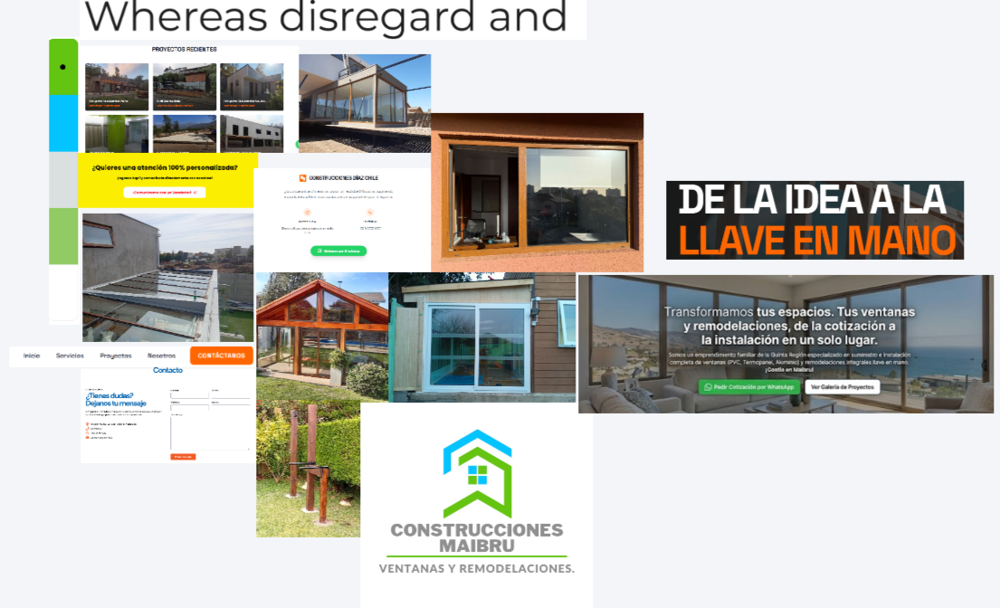

# Moodboard — Construcciones Maibru SpA

> Guía: [Moodboard](../evaluacion/guias/fase-2-specs/02-moodboard.md)

**Tablero en Whimsical:** [https://whimsical.com/duocuc91/Coe1nPuB6qTaaBS39TeFZK]

## Palabras clave

- **Confiable:** Camila necesita sentir seguridad antes de contratar.
- **Sólido:** transmite experiencia y trabajo bien hecho en construcción.
- **Claro:** información ordenada y fácil de entender.
- **Cercano:** atención directa y trato personal, sin sentirse una gran corporación.
- **Luminoso:** espacios amplios y mucha luz, como las ventanas que se instalan.
- **Profesional:** colores sobrios y fotografías reales de trabajos.

## Qué sensación buscamos

El sitio debe transmitir confianza, solidez y claridad, con un toque cálido y cercano. Busco un estilo limpio y luminoso, con mucho espacio en blanco y fotografías reales de trabajos, para que se vea profesional sin parecer frío.

Esto conecta con Camila porque ella quiere encontrar a alguien confiable y que le dé información clara. Un diseño ordenado le ayuda a entender rápido qué ofrece la empresa, y las fotos reales y los colores sobrios le dan seguridad antes de escribir por WhatsApp.
