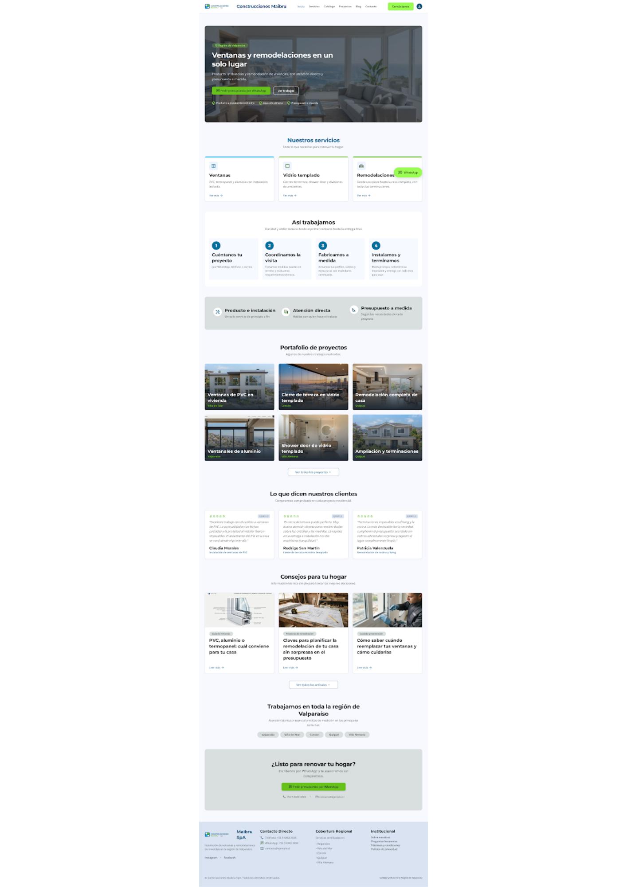
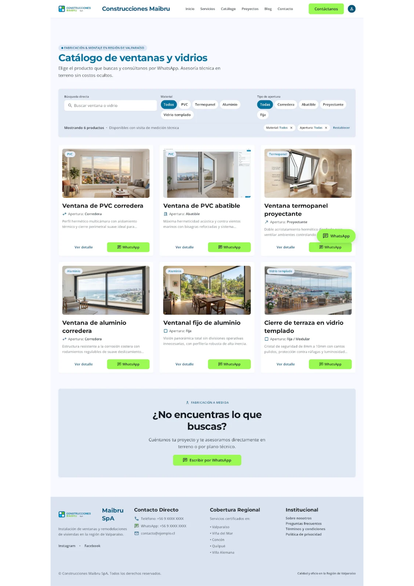
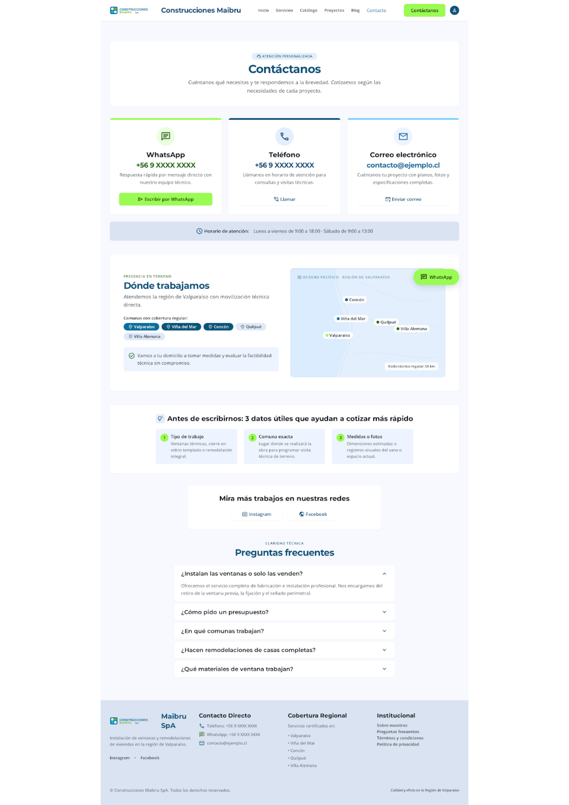
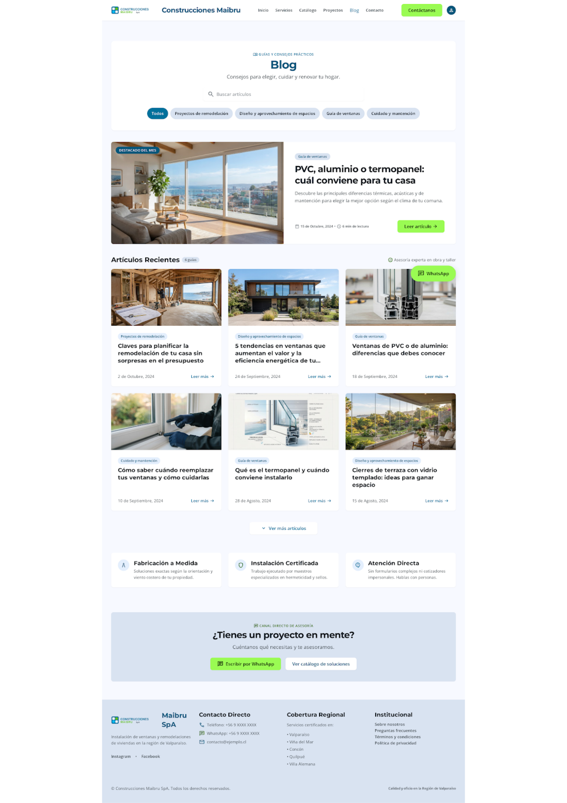
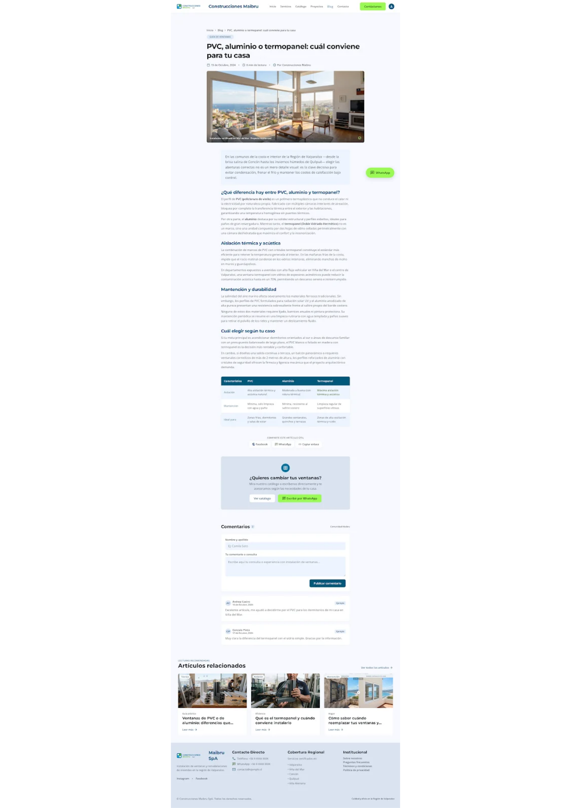

# QA — Construcciones Maibru SpA

> Guía: [QA y coherencia](../evaluacion/guias/fase-3-prototipo/02-qa-y-coherencia.md)

## Prototipo en Stitch

> Guía: [Prototipo en Stitch](../evaluacion/guias/fase-3-prototipo/01-prototipo-en-stitch.md)

**Proyecto:** https://stitch.withgoogle.com/projects/6390268588653236707

<!-- Capturas en docs/img/, por ejemplo:  -->

| Pantalla | Desktop | Mobile |
|---|---|---|
| Landing |  |  |
| Tienda (Catálogo) |  |  |
| Ficha de producto |  |  
| Carrito (reemplazado por Contacto) |  |  |
| Blog |  |  |
| Artículo |  |  |

## Revisión: spec vs. prototipo

<!-- Una fila por diferencia. Resultado: ✅ / ❌ → ✅ / ❌ -->

| Pantalla | Qué dice la spec | Qué generó Stitch | Resultado | Corrección |
|---|---|---|---|---|
| Todas (desktop) | Navbar con el logo una sola vez y el menú Inicio, Servicios, Catálogo, Proyectos, Blog y Contacto | En la primera versión repitió la imagen del logo como primera opción del menú | ❌ → ✅ | Agregué al prompt "No repitas el logo dentro del menú" y volví a generar |
| Todas | Navbar sin elementos extra | Agregó un ícono de usuario | ❌ → ✅ | Pedí eliminarlo |
| Todas | Botón de WhatsApp en verde #66C21A con texto oscuro | Usó un verde más claro y brillante | ❌ → ✅ | Indiqué el HEX exacto en el prompt |
| Todas | Botón flotante de WhatsApp sin tapar contenido | El botón tapaba el texto "Calidad y oficio…" del footer | ❌ → ✅ | Pedí margen inferior en el footer |
| Todas | Sin precios, carrito ni formularios | No hay precios, carrito ni formularios de cotización en desktop | ✅ | Sin cambios |
| Todas | Teléfono y correo como marcadores | Usó "+56 9 XXXX XXXX" y "contacto@ejemplo.cl" | ✅ | Sin cambios |
| Landing | Hero, servicios, así trabajamos, confianza, portafolio 3x2, experiencias, blog, cobertura y llamado a la acción | Incluye todas las secciones, con la ubicación de cada proyecto | ✅ | Sin cambios |
| Landing | Opiniones de clientes marcadas como "Ejemplo" | Mostró 3 opiniones con estrellas, sin la etiqueta | ❌ → ✅ | Pedí agregar la etiqueta "Ejemplo" |
| Landing (mobile) | Tarjeta "Ventanas": PVC, termopanel y aluminio | Dijo "Ventanas Termopanel y PVC" | ❌ → ✅ | Corregí el título y la descripción |
| Tienda | Filtros de búsqueda, material (5) y apertura (5), contador y 6 productos | Incluye todo, más chips de filtros activos | ✅ | Sin cambios |
| Tienda | Botón "Consultar por WhatsApp" en cada tarjeta | Los botones de desktop decían solo "WhatsApp" | ❌ → ✅ | Pedí cambiar el texto |
| Tienda | La empresa instala productos fabricados por un proveedor | Escribió "Fabricación & montaje" y "Fabricamos soluciones especiales" | ❌ → ✅ | Reescribí los textos sin hablar de fabricación propia |
| Ficha de producto | Selector con material, apertura, vidrio, y campos de ancho y alto vacíos | Incluyó todo, pero los campos vinieron con medidas escritas | ❌ → ✅ | Pedí dejar los campos vacíos |
| Ficha de producto | Sin promesas ni certificaciones inventadas | Agregó "Instalación certificada", "Garantía directa", "Fabricación nacional", "Paso 1 de 3" y un recuadro "Compromiso Maibru" | ❌ → ✅ | Pedí eliminarlos y usar marcadores como [GARANTÍA] |
| Ficha de producto (mobile) | Productos relacionados sin precio ni cotización | Una tarjeta mostró un precio y los botones "Cotización instantánea" y "Solicitar instalación" | ❌ → ✅ | Pedí que las 3 tarjetas fueran iguales a las de desktop, con "Ver detalle" |
| Ficha de producto | 4 beneficios, "¿Qué incluye?", 3 acordeones y 3 productos relacionados | Incluye todo | ✅ | Sin cambios |
| Contacto | 3 tarjetas, horario, cobertura con mapa, "Antes de escribirnos", redes y 5 preguntas frecuentes | Incluye todo, sin formulario | ✅ | Sin cambios |
| Contacto | Sin secciones extra ni promesas inventadas | Agregó "¿Conversamos hoy mismo?" con "Iniciar chat técnico" y escribió "Vamos a tu domicilio… sin compromiso" y "fabricación a medida" | ❌ → ✅ | Pedí eliminar el bloque y reescribir los textos |
| Blog | Buscador, 5 chips, destacado, 6 tarjetas y llamado a la acción solo con WhatsApp | Incluye todo, más 3 recuadros extra ("Fabricación a Medida", "Instalación Certificada", "Atención Directa") y el botón "Ver catálogo de soluciones" | ❌ → ✅ | Pedí eliminar los recuadros y el botón extra |
| Artículo | Texto limpio, 4 subtítulos, tabla, compartir, comentarios y relacionados | Incluye todo, pero con "hasta un 70 %" de reducción de ruido, "Instalación certificada" en la foto y asteriscos sueltos en el texto (mobile) | ❌ → ✅ | Pedí quitar las cifras, la etiqueta y los asteriscos |
| Mobile (todas) | Menú de hamburguesa, una columna y botones a ancho completo | Cumple en las 6 pantallas | ✅ | Sin cambios |
| Mobile (todas) | Navegación solo con el menú del navbar | Agregó una barra inferior (Inicio, Catálogo, Blog, Contacto) que chocaba con el botón de WhatsApp | ❌ → ✅ | Pedí eliminarla en cada pantalla |
| Ficha y Artículo (mobile) | Navbar con logo y botón de menú | Usó una barra con flecha de volver y el título de la pantalla | ❌ → ✅ | Pedí el mismo navbar del resto del sitio |
**Nota:** el sitio no tiene carrito, porque el contacto es directo por WhatsApp, teléfono o correo. Por eso la pantalla de Carrito se reemplazó por Contacto.

## Mejoras a mis specs

<!-- Qué cambiaste en DESIGN.md o en tus prompts después de ver el resultado. -->
- **Un prompt por pantalla.** Al enviarle todo junto, Stitch solo generó la landing. Pasé a un prompt numerado con las 6 pantallas y luego a prompts cortos por pantalla para las correcciones.
- **Reglas obligatorias al final del prompt.** Agregué reglas fijas: sin precios, sin formularios, sin datos inventados y con el logo una sola vez. Con eso desaparecieron el logo repetido y los teléfonos falsos distintos.
- **Prohibir afirmaciones sobre la empresa.** Stitch inventó garantías, certificaciones, porcentajes y fabricación propia. Agregué "No escribas garantías, certificaciones ni cifras, y no digas que la empresa fabrica: solo instala productos fabricados por un proveedor".
- **Color exacto del botón.** Pasé a indicar el HEX #66C21A en cada prompt, porque el verde salió más brillante.
- **Solo los componentes de la spec.** Agregué "No agregues secciones, íconos ni recuadros que no estén en esta indicación", porque en mobile aparecieron una barra inferior y bloques de chat.
- **Navbar mobile definido.** En el prompt mobile pedí el mismo navbar con hamburguesa en todas las pantallas y sin barra inferior.
- **Cambios pequeños y por separado.** Cuando un prompt largo de correcciones no se aplicó, lo dividí en un prompt corto por pantalla.
-

## User flows

| Flujo | Recorrido en el prototipo | ¿Se completa? |
|---|---|---|
| Compra | Landing → "Ver ventanas" → Catálogo → filtro por material → "Ver detalle" → Ficha de producto → "Consultar por WhatsApp" | [✅ / ❌] |
| Contenido | Blog → "Leer artículo" → Artículo → "Ver catálogo" → Catálogo → "Ver detalle" → Ficha de producto → "Consultar por WhatsApp" | [✅ / ❌] |
| Confianza | Landing → "Ver trabajos" → Portafolio de proyectos → "Contáctanos" → Contacto | [✅ / ❌] |

## Coherencia

El prototipo responde al brief: el sitio sirve para que una persona conozca los servicios de Construcciones Maibru, vea trabajos reales y contacte rápido por WhatsApp, teléfono o correo. Las 6 pantallas repiten el mismo navbar, footer y botón flotante de WhatsApp, y el botón verde es siempre el elemento más visible.

También responde a Camila, la proto-persona: busca desde el celular, revisa fotos de trabajos antes de contactar, compara servicios y quiere información clara y una respuesta rápida. Por eso la landing tiene un portafolio con fotos y ubicación, el catálogo no muestra precios, la ficha termina en una consulta por WhatsApp con las opciones elegidas, y todas las pantallas tienen versión mobile con botones grandes.

Frente a sus frustraciones, el sitio ofrece información clara de los servicios y los materiales, contacto directo en un solo toque y una zona de cobertura visible, para que Camila sepa si la empresa trabaja en su comuna.

Desde la Fase 1 cambiaron cuatro cosas:

- Se eliminó la cotización directa y el carrito: el contacto es directo, y la pantalla de Carrito pasó a ser Contacto.
- Se agregaron experiencias de clientes, el portafolio de proyectos y los enlaces a Instagram y Facebook, para generar más confianza.
- El catálogo incorporó el vidrio templado como material, porque es parte de lo que ofrece la empresa.
- La paleta pasó del naranja de los botones de contacto al verde vivo, para mantener los colores de la marca.
